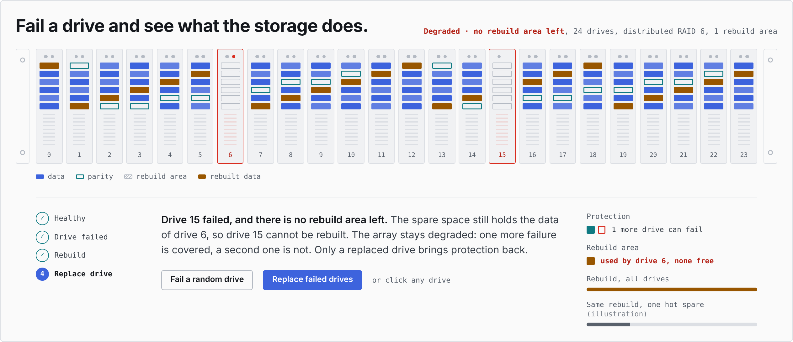

# fail-a-drive

**Fail a drive and see what the storage does.** [Live demo](https://rubesak.github.io/fail-a-drive-drill/)

An interactive failure drill for a distributed RAID 6 drive array, for blogs, talks, docs and training pages. Click a drive and watch the array go degraded, rebuild into spare space spread across every drive, get protected again and copy data back to the replacement drive. Fail a second drive during the rebuild and the array goes critical. Fail a third one and the data is gone, so the only button left is *Restore from backup*.

<picture>
  <source media="(prefers-color-scheme: dark)" srcset="docs/screenshot-dark.png">
  
</picture>

- Vanilla JS and CSS, no dependencies, about 33 kB unminified (JS and CSS together)
- Works under a strict Content Security Policy: no `innerHTML`, no inline styles or scripts needed
- Light and dark theme (follows the system or can be forced), themeable with CSS custom properties
- Responsive by container width, not viewport width, so it fits a sidebar as well as a full-width hero
- Respects `prefers-reduced-motion`
- Several instances per page, a small JS API and DOM events

## What it shows

1. **Healthy.** Every drive holds data strips, parity strips and a slice of the rebuild area: spare space for the data of one failed drive, spread over all drives.
2. **Drive failed.** No data is lost. Missing blocks are calculated from data and parity on the other drives. Protection drops from two drives to one.
3. **Rebuild.** All remaining drives rebuild the lost data at the same time, into the rebuild area spread over them. A second bar shows the same rebuild with one dedicated hot spare, which has to take every write alone (an illustration, not a benchmark).
4. **Replace drive.** The visitor replaces the failed drive. The data is copied back to the new drive and the rebuild area is free again.

A second failure during the rebuild leaves no protection. A third drive without rebuilt data takes the pool offline.

Rebuild areas are limited. Each failed drive keeps one rebuild area in use until it is replaced, so a finished rebuild does not make the array safe for ever. With one rebuild area (the default), fail a drive, let it rebuild and fail another one: the second drive has nowhere to rebuild, so the array stays degraded until the drives are replaced. Two more failures and the data is gone.

The model is deliberately simple. It teaches the idea behind distributed (declustered) RAID and why rebuild time matters. It is not a simulation of any specific product, and the timings are not real.

## Quick start

Copy `dist/fail-a-drive.css` and `dist/fail-a-drive.js` to your site and add:

```html
<link rel="stylesheet" href="fail-a-drive.css">

<div data-fail-a-drive>
  <!-- Optional fallback, shown when JavaScript is off. It is replaced on mount. -->
  <p>Interactive demo of a 24-drive distributed RAID 6 array.</p>
</div>

<script src="fail-a-drive.js" defer></script>
```

The classic script mounts every `[data-fail-a-drive]` element when the page loads and exposes `window.FailADrive`.

The same files are available from jsDelivr, which serves them from the tagged release in this repository:

```html
<link rel="stylesheet" href="https://cdn.jsdelivr.net/gh/rubesak/fail-a-drive-drill@v1.1.0/dist/fail-a-drive.css">
<script src="https://cdn.jsdelivr.net/gh/rubesak/fail-a-drive-drill@v1.1.0/dist/fail-a-drive.js" defer></script>
```

### As an ES module

Install it straight from GitHub (the package is not published to npm):

```bash
npm install github:rubesak/fail-a-drive-drill#v1.1.0
```

```js
import { mount } from 'fail-a-drive';
import 'fail-a-drive/style.css'; // or link dist/fail-a-drive.css yourself

const drill = mount('#drill', { drives: 12, rebuildMs: 4000 });
drill.fail(3);      // fail drive 3
drill.replace();    // replace the failed drives once the rebuild is done
drill.reset();      // back to healthy
drill.destroy();    // stop timers, put the original content back
```

## API

| Export | Description |
| --- | --- |
| `mount(target, options?)` | Renders the drill into `target` (an element or a CSS selector), replacing its content, and returns a controller. Mounting the same element again replaces the earlier instance |
| `autoInit(selector?)` | Mounts every element that matches `selector` (default `[data-fail-a-drive]`) and is not mounted yet. Returns the new controllers |
| `defaults` | The default options |
| `strings` | The default texts |

The controller has `root` (the `.fad` element), `fail(index)` (0-based), `failRandom()`, `replace()`, `reset()` and `destroy()`. `destroy()` stops all timers and listeners and puts the element's original content back.

## Options

Pass them to `mount(el, options)` or as `data-*` attributes (`data-drives="12"`, `data-rebuild-ms="4000"`, `data-theme="dark"`, `data-title="..."`, `data-heading-level="3"`, `data-animate="false"`, `data-rebuild-areas="2"`, `data-auto-replace`).

| Option | Default | Description |
| --- | --- | --- |
| `drives` | `24` | Number of drives, 6 to 48 |
| `rows` | `6` | Strips shown per drive, 3 to 12 |
| `stripe` | `12` | Stripe width used to place the parity strips |
| `rebuildMs` | `7000` | Rebuild time for one drive |
| `spareSlower` | `4` | How much slower the "one hot spare" bar is |
| `rebuildAreas` | `1` | Rebuild areas (distributed spare capacity), 1 to 4. Each one holds the data of one failed drive until that drive is replaced |
| `detectMs` | `2400` | Pause between a failure and the start of the rebuild |
| `autoReplace` | `false` | Replace failed drives without the visitor, after `holdMs` |
| `holdMs` | `4200` | With `autoReplace`: pause before the failed drives are replaced |
| `copybackMs` | `3600` | Copyback time |
| `theme` | `'auto'` | `'auto'`, `'light'` or `'dark'` |
| `title` | `'Fail a drive and see what the storage does.'` | Heading text |
| `headingLevel` | `2` | `2` to `6`, or `0` for no heading (the title becomes an `aria-label`) |
| `animate` | `true` | Background I/O blinks and the power-on effect. Always off with reduced motion |
| `strings` | `{}` | Override any text, see below |

## Text and translations

Every text lives in `strings` and can be replaced in part. Strings may be plain text or functions. In the story texts, `**text**` is shown in bold; nothing else is parsed, and all text is inserted as text nodes.

```js
mount('#drill', {
  title: 'What happens when a drive dies?',
  strings: {
    failButton: 'Pull a drive',
    hint: 'or pick one',
    state: { rebuilding: (pct) => `Rebuild at ${pct}%` },
    story: { failed: (d) => `**Drive ${d} is gone.** The data is still there.` },
  },
});
```

See `strings` in `src/fail-a-drive.mjs` (or `FailADrive.strings`) for the full list.

## Theming

All colours are custom properties on `.fad`. Override them on the element or any ancestor:

```css
.fad {
  --fad-data: #7c3aed;      /* data strips, primary button, current step */
  --fad-parity: #0d9488;    /* parity strips, healthy state, protection */
  --fad-rebuild: #b45309;   /* rebuild progress, rebuilt data */
  --fad-fault: #dc2626;     /* failed drives */
  --fad-fault-ink: #b91c1c; /* failure text */
  --fad-bg: transparent;    /* panel background */
  --fad-font: "Your Sans", system-ui, sans-serif;
  --fad-mono: "Your Mono", ui-monospace, monospace;
}
```

Other tokens: `--fad-bay`, `--fad-line`, `--fad-line-strong`, `--fad-fg`, `--fad-fg-soft`, `--fad-muted`, `--fad-on-data`, `--fad-fault-soft`, `--fad-radius`. The dark values are set under `@media (prefers-color-scheme: dark)` and on `.fad[data-theme="dark"]`; force a theme with the `theme` option or by setting `data-theme` on the `.fad` element.

## Events

Both events bubble from the `.fad` element.

| Event | `detail` | When |
| --- | --- | --- |
| `faildrive:status` | `{ status, failed }` | The array status changes: `online`, `degraded`, `rebuilding`, `critical`, `protected`, `copyback`, `offline`. `failed` lists the failed drive indexes |
| `faildrive:rebuild` | `{ drives }` | A rebuild starts |

```js
document.addEventListener('faildrive:status', (e) => console.log(e.detail.status));
```

## Accessibility

- The story text is an `aria-live="polite"` region, so every step is announced in plain sentences.
- The drive picture, legend and meters are decorative (`aria-hidden`). Everything they show is also in the story text.
- Keyboard users use the *Fail a random drive* button. If that button has focus when the array goes offline, focus moves to *Restore from backup*, and back again after the restore.
- With `prefers-reduced-motion: reduce` there is no blinking, no background I/O and no transitions. The rebuild still progresses, since it is the content.

## Content Security Policy

The component needs only `script-src` and `style-src` for its own files. It sets a few CSS custom properties and transforms through the CSSOM (`element.style.setProperty`), which CSP allows even without `'unsafe-inline'`. The demo page runs under:

```
default-src 'none'; script-src 'self'; style-src 'self'; img-src 'self'
```

## Browser support

Current Chrome, Edge, Firefox and Safari. It uses CSS container queries and the `container` shorthand (Safari 16+, Chrome 105+, Firefox 110+).

## Development

The source is in `src/`; `dist/` is generated from it and committed, so the files can be used without a build step.

```bash
npm run build   # build dist/ from src/ (no dependencies)
npm run demo    # build and serve the demo on http://localhost:8080
```

Tests run in headless Chromium through Playwright:

```bash
npm install
npx playwright install chromium
npm test        # checks that dist/ matches src/, then runs test/drill.test.mjs
```

## Credits

Built with help from Claude (Anthropic). Design, review and decisions by Michal Rubes.

## License

[MIT](LICENSE)
